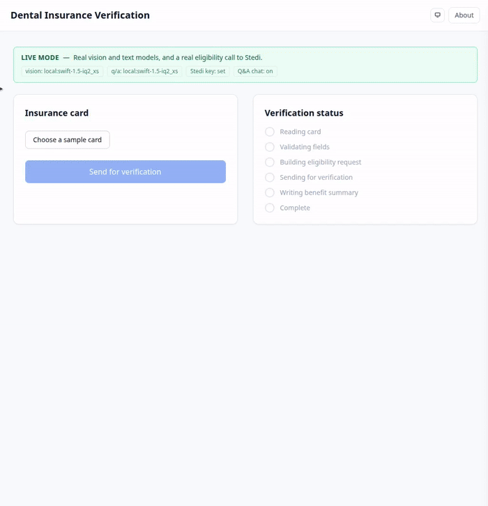

# Dental Insurance Verification

A working pipeline that turns a photo of a **dental insurance card** into a verified
eligibility result and a plain-English benefit summary.

> **No real patient data.** Every card in this repo is synthetically generated.
> This is a HIPAA-minded demo, not a production system.

**Why local-first.** The original plan for this project was a local-only system: the
pipeline runs on your machine, the vision model runs on your GPU, and the only
external call is the eligibility request to a clearinghouse. Cloud providers
(OpenRouter, OpenAI) are an option for the demo because every card in this repo is
synthetic — there is no PHI. In production the story stays local.

## The demo



A web app: pick a sample card, hit **Send for verification**, and watch the pipeline
run in real time — *reading card → validating → sending for verification → done* —
then get a plain-English benefit summary back. The status strip shows the backend
actually working, not a fake animation.

The result panel shows, in order:

- **OCR read** — a collapsible fold with exactly what the vision model read off the
  card (member ID, group, payer, plan, subscriber), with confidence.
- **Ask** — a grounded Q&A chat over the run's parsed 271 (llm and live tiers).
- **Benefit summary** — the patient's coverage and per-category benefits at a glance.
- **Benefit coverage** — every covered / not-covered procedure code the 271 reports.
- **Raw 271 response** — the full response, formatted as X12 segments and as JSON.

## How it works

```
card photo ──► extract (VLM: local model server, OpenRouter, or OpenAI)
   ──► validate (payer lookup, ID formats, cross-field checks)
   ──► 270 request ──► (mock 271 / Stedi sandbox)
   ──► summarize ──► plain-English benefit summary
```

One flag, `IV_MODE`, bundles every backend switch into three tiers. A tier without
its keys fails fast at startup — nothing silently falls back to mock:

| Tier | Keys | Extraction | Eligibility | Q&A chat |
|---|---|---|---|---|
| `mock` (default) | none | card sidecar answer key, no model | deterministic mock 271 | off |
| `llm` | model provider keys | real VLM OCR | mock 271 | on |
| `live` | Stedi + model provider keys | real VLM OCR | real Stedi 270/271 | on |

Models are chosen by prefix: `openrouter:` routes to OpenRouter, `openai:` to OpenAI,
`local:` (or a bare model name) to a local model server speaking the OpenAI
chat-completions format. Local models need no key. All tiers share the same schemas,
validators, and pipeline.

## Quick start

```bash
# Backend (FastAPI pipeline + SSE event stream)
uv sync
cp .env.example .env   # then fill in keys; mock needs none, llm needs the key for
# each model provider its models use, live adds STEDI_API_KEY
uv run uvicorn insurance_verify.api:app --port 8000

# Frontend (Next.js demo) — in another terminal
cd frontend
npm install
npm run dev -- -p 3100
```

Open http://localhost:3100, pick a sample card, and hit **Send for verification**.

Generate a batch of synthetic cards with ground truth:

```bash
uv run python -m synth.generate --count 5 --out synth/output
```

## Configuration

Every option is documented in [`.env.example`](.env.example). The env vars:

| Env var | Default | Purpose |
|---|---|---|
| `IV_MODE` | `mock` | The tier flag: `mock` / `llm` / `live` |
| `IV_VISION_MODEL` | `openai:gpt-6-luna` | Vision model for real OCR; prefix picks the provider, a bare name the local server |
| `IV_ASK_MODEL` | `openai:gpt-6-luna` | Text model for the Q&A chat, same prefix rule |
| `IV_LOCAL_URL` | `http://localhost:11434/v1` | Local model server (OpenAI-compatible endpoint root) |
| `IV_OPENROUTER_API_KEY` | — | OpenRouter key (falls back to `OPENROUTER_API_KEY`); required when a model uses `openrouter:` |
| `IV_OPENAI_API_KEY` | — | OpenAI key (falls back to `OPENAI_API_KEY`); required when a model uses `openai:` |
| `STEDI_API_KEY` | — | Stedi eligibility key; required for `live` |
| `IV_DATA_DIR` | `synth/output` | Generated card output directory |
| `IV_CONFIDENCE_THRESHOLD` | `0.7` | Confidence below which a card escalates to human review |

## Privacy

Every card in the repo is synthetic. This is a HIPAA-minded demo, not a
compliance claim: production eligibility calls through a clearinghouse require a
BAA and the deploying organization's policies.

## Repo layout

```
insurance-verify/
  README.md            # demo, architecture
  docs/                # demo media (demo.gif)
  src/insurance_verify/
    schemas/           # Pydantic models: card, 270/271, benefit summary
    extract/           # VLM extraction (local server / OpenRouter / OpenAI)
    benefits/          # 271 parser, CDT/STC code maps
    eligibility/       # mock 270/271 server, Stedi sandbox client
    summarize/         # 271 to plain-English benefit summary
    pipeline.py        # plain-Python orchestration tying it together
    events.py          # real-time pipeline event stream (SSE)
    api.py             # FastAPI app: /verify + /events/{job_id}
  data/cards/          # committed synthetic sample cards + ground-truth sidecars
  frontend/            # Next.js demo: card picker, live status, result
  synth/               # card templates, generator
```
